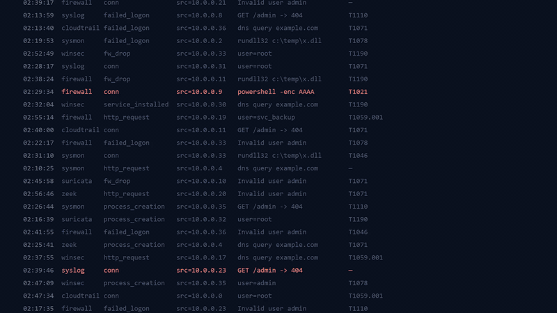
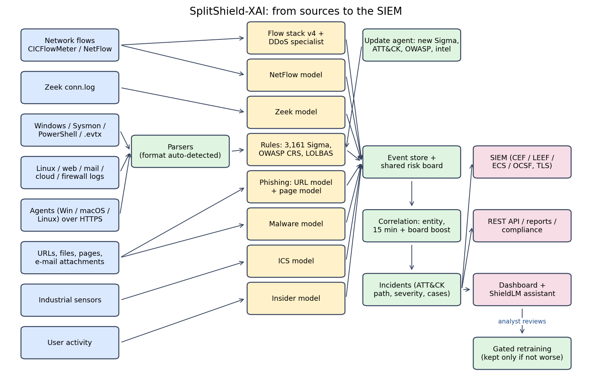

# 🛡️ SplitShield-XAI

**Your SIEM shows alerts. SplitShield-XAI shows the attack.**

  

▶ The preview loops on its own; <a href="assets/splitshield-demo.mp4">click it to play the full video with sound</a>.

  
  
  
  

**An explainable detection and response layer that works next to your SIEM.** It finds
attacks in network traffic, logs, web requests, URLs, files, industrial sensors and user
activity, links them into incidents along the MITRE ATT&CK chain, explains each one in plain
English and forwards it to your SIEM. It is a SIEM companion, not a SIEM replacement.

## ✨ Features

- **Detection everywhere:** 9 models (network flows, NetFlow, Zeek, phishing, malware,
  industrial control, insider threat and two for the assistant) and 3,600+ rules (SigmaHQ,
  OWASP CRS, LOLBAS / GTFOBins, own rules).
- **Incidents, not alert floods:** findings about the same IP, user, host, URL or file are
  linked into one incident with its ATT&CK path, and severity rises when sensors agree.
- **Explanations:** every alert says why it fired; the dashboard assistant answers questions
  such as *is lateral movement happening?* or *what did 203.0.113.45 do?* from your own data.
- **Works with any SIEM:** CEF, LEEF, ECS or OCSF over syslog (TCP / TLS) or webhook, with
  guaranteed delivery.
- **Yours to adapt:** change any rule, threshold or setting, approve proposals learnt from
  analyst reviews, and let the update agent keep Sigma, ATT&CK and OWASP current.
- **Agents** for Windows, macOS and Linux, users and roles, an audit log and a read-only
  REST API.

## 🔗 How it fits together

Inside each detector (flow stack, phishing, assistant): Figures 2-4 of the final report.

## 🚀 Quick start

First download **SplitShield-XAI-models.zip** (trained models and Word reports) from
**Releases** and unzip it into the project folder. Then:

| | Install | Start |
|---|---|---|
| 🪟 Windows | double-click `INSTALL.cmd` | `START.cmd` or the desktop shortcut |
| 🍎 macOS / 🐧 Linux | `sh install.sh` | `sh START.sh` |

The installer sets up the libraries (about 10 minutes), checks every model and opens the
dashboard at `http://localhost:8501`, where you create the admin account. Requires 8 GB RAM
and about 4 GB of disk. Agents, certificates and troubleshooting: [INSTALL](docs/INSTALL.md).

## 📊 Results

*Held-out*: data never used to build or tune a model. *Blind*: separate datasets scored once.

| Area | Held-out | Blind |
|---|---|---|
| 🌐 Network flows | 99.7 % caught, 0.17 % false alarms | CIC-IDS2018: 56.1 %; HIKARI: 13.2 % ❌ |
| 🪟 Windows events | 53.9 % right ATT&CK tactic | EVTX-to-MITRE: 55.2 % detected |
| 🐧 Linux / cloud logs | 40.9 % right tactic | Splunk: 43.8 % detected |
| 🎣 Phishing URLs | precision 0.997, recall 0.60 | OpenPhish: precision 1.00, recall 0.74 |
| 🦠 Malware files | 92.6 % at 1 % false positives | EMBER 2017: 95.0 % |
| 🏭 Industrial control | precision 0.90 / 0.70 | HAI 21.03: does not transfer ❌ |
| 👤 Insider threat | F1 0.95 | CERT r4.1: 3 of 3 insiders found |

Weak spots are reported as measured. Full results: [RESULTS](docs/RESULTS.md) ·
known limits: [LIMITATIONS](docs/LIMITATIONS.md).

The project also contains a research study on split learning, explanations and attacks
(hypotheses H1–H5, five seeds each): [RESEARCH](docs/RESEARCH.md).

## 📚 Documentation

| Document | Contents |
|---|---|
| Final report and case study (.docx) | Everything, with diagrams; in **SplitShield-XAI-models.zip** (Releases), unzipped to `results/` |
| [INSTALL](docs/INSTALL.md) | Requirements, install, agents, certificates, troubleshooting |
| [RESULTS](docs/RESULTS.md) · [MODEL_CARDS](docs/MODEL_CARDS.md) | Results and one card per model |
| [RESEARCH](docs/RESEARCH.md) · [DATASETS](docs/DATASETS.md) | Research hypotheses, datasets and citations |
| [ENTERPRISE](docs/ENTERPRISE.md) · [UPDATE_AGENT](docs/UPDATE_AGENT.md) | Team features and the update agent |
| [SECURITY](docs/SECURITY.md) · [LIMITATIONS](docs/LIMITATIONS.md) | Penetration test and known limits |
| [DEVELOPMENT](docs/DEVELOPMENT.md) | File layout, running the tests, how to cite |

## 📄 License

Code: MIT, see [LICENSE](LICENSE). SigmaHQ rules: Detection Rule License 1.1. OWASP CRS:
Apache-2.0. MITRE ATT&CK® © The MITRE Corporation. Datasets © their authors
([DATASETS](docs/DATASETS.md)).
# SplitShield-XAI
