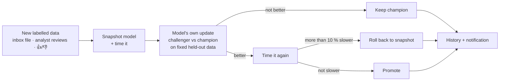

# 🤖 Self-improvement, automation and health

[← Back to the main README](../README.md)

SplitShield-XAI keeps improving itself, but **every automatic change is gated**: it is
kept only if it is not worse on fixed held-out data and not slower; otherwise it is
rolled back. Code is never changed automatically: speed-ups are *proposed* and wait for
the owner. Everything shows on the dashboard's **🧬 Self-improvement & health** page,
and important decisions pop up as Windows notifications.

## 🧬 One controller around all 9 models

The SOC has nine specialist models, one per kind of input (a single model cannot read
URLs, executables, sensor streams and logs at once). One controller,
`src/soc/controller.py`, wraps every one of them in the same guard:

| # | Model | Learns from | Held-out gate |
|---|---|---|---|
| 1 | Flow detector (CICFlowMeter) | analyst reviews (Real / False alarm); flow CSVs in its inbox | macro-F1 on held-out reviewed flows must not dip |
| 2 | NetFlow detector | NetFlow CSVs | F1 on a fixed NF-CSE-CIC-IDS2018 validation sample |
| 3 | Zeek model | labelled `conn.log` files | F1 on a fixed IoT-23 validation sample (unseen captures) |
| 4 | Phishing URL model | `url,label` CSVs | F1 on the fixed PhiUSIIL validation hosts |
| 5 | Malware model | EMBER feature JSONL | detection at 1 % false positives on the fixed hold-out |
| 6 | ICS model | plant sensor CSVs (normal rows) | injected-fault F1 on the fixed validation period |
| 7 | Insider model | user-day CSVs | PR-AUC on the validation user-days |
| 8 | Question understanding | 👍 / 👎 on assistant replies | accuracy on held-out question templates + rated questions |
| 9 | ShieldLM | 👍 / 👎 on incident narratives | faithfulness gate (nightly) |

**Inbox:** drop a labelled file into `artifacts/inbox/<model>/` (or use the upload box
on the 🧬 page). The next hourly cycle learns from it and moves it to `done/`. The fixed
held-out and replay samples live next to each model, so this keeps working after the
datasets are removed (pendrive copy).

## ⚡ Speed: nightly profiling and code proposals

Once a night (02:00–05:00), `src/soc/codeopt.py`:

1. **profiles** every model's throughput, the log-rule engine, **searches** and **whole
   assistant answers** (on a temporary 50,000-event practice store, never your own),
   and lists the slowest functions; a workload more than 20 % slower than the night
   before raises a notification;
2. **proposes code speed-ups** for the slowest functions from a built-in catalogue of
   safe changes (for example, compiling a regular expression once instead of on every
   call). Loops over `DataFrame.iterrows()` are flagged as advice, because they need a
   human rewrite;
3. **tries each proposal in a sandbox copy** of the project: benchmark before and after
   in fresh processes, plus the full test suite. Only proposals that pass every test, are
   at least 3 % faster, and leave search and chat no more than 5 % slower are offered.

A model update that would make its model more than 10 % slower is rolled back by the
controller (above). When a nightly update could not train at all (for example ShieldLM
before there are 4 incidents or any feedback), the history says **not trained** and
why, instead of "kept champion".

On the 🧬 page you see the diff, the measured speed-up and the test result, then choose
**Approve & apply**, **Reject** or later **Revert**. Applying re-runs all tests on the
real project and reverts on failure. Everything stays on this PC.

## 🛫 Scheduled tasks

| Task | What it does | When |
|---|---|---|
| 🛫 Autopilot (`scripts/autopilot.py`) | Drift check (PSI); retrain from analyst reviews; controller cycle over all inboxes and ratings; health watch; nightly ShieldLM update; nightly profiling and proposals | Hourly |
| 📄 Daily report (`src/soc/reports.py`) | Yesterday's SOC report every morning, the last 7 days on Mondays (Markdown + Word in `results/reports/`), with a pop-up | From the autopilot, 07:00-10:00 |
| 🔗 Risk-board check (`src/soc/riskboard.py`) | Switches the cross-model severity boost on only when 20+ reviewed incidents show precision does not drop | From the autopilot |
| 📍 Place check (`src/soc/places.py`) | Weekly re-guess of where the SOC runs; asks you (or switches, if you chose fully automatic) | From the autopilot |
| 🧬 Evolve loop (`src/soc/evolve.py`) | Tries faster or more accurate settings of the rule engine on a fixed benchmark; kept only if detection does not drop, false alarms do not rise and it is faster | From the autopilot |
| 🌐 Update agent (`scripts/update_agent.py`) | New Sigma rules, ATT&CK release and threat-intel feeds, gated, with rollback ([details](UPDATE_AGENT.md)) | Daily (on by default; Settings → Updates switches it off) |
| 🖥️ Live logs (`src/soc/winlive.py`) | New Security / Sysmon / PowerShell records of this PC every 2 s (Settings: live.poll_s), read-only ([details](SOC.md)) | At logon, keeps running |
| 🐕 Watchdog (`scripts/supervisor.py`) | Keeps a long training run going through crashes and power cuts (retries, memory fallback) | At boot |
| 💾 Backup (`scripts/backup.py`) | Models, results and code to `D:\SplitShield-backups`, last 7 days | Daily 03:30 |

## 🩺 Health watch

Every hour the controller checks that each part is alive: autopilot, controller cycle,
update agent (if on), evolve loop, Sysmon and the nightly profile. Anything that turns
red raises a notification once. **🩺 Check health now** on the 🧬 page also loads all 9
models and times them.

## 🚫 What is never automatic

- Blocking an attacker.
- Changing code (proposals only).
- Updating Python packages.
- Turning on the update agent.
